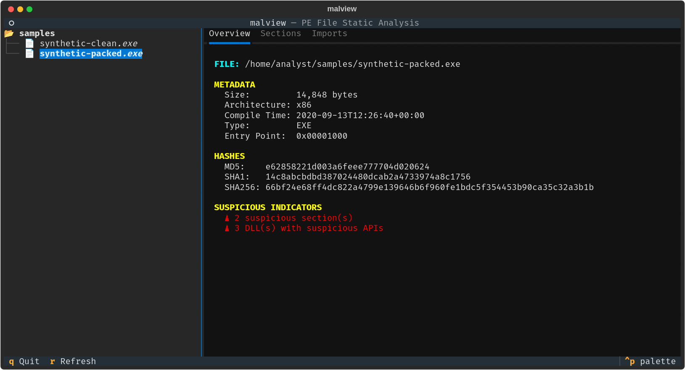
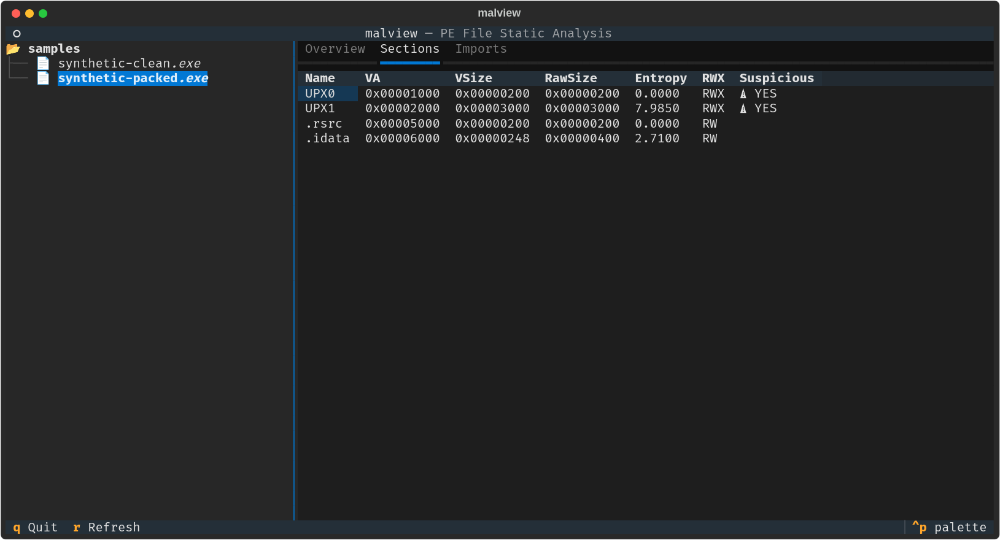
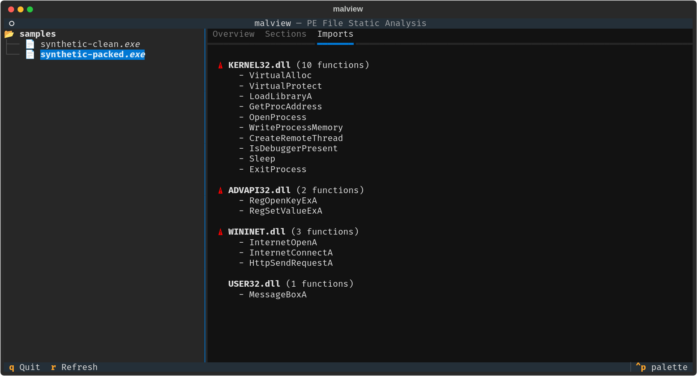

# malview

Static triage for Windows PE files: a CLI and a terminal UI that combine
pefile, YARA, and Mandiant's capa and FLOSS into one report, with a heuristic
risk score that tells you where to look first.

It was built to speed up the first pass on a suspicious executable: hashes,
headers, sections, imports, rule matches and decoded strings in one place,
without running the sample.



<sub>All screenshots use harmless synthetic PE files built by
[tests/pe_builder.py](tests/pe_builder.py), not real malware.</sub>

## What it reports

**Fast pass** (pure Python, under a second for typical files):

- MD5 / SHA-1 / SHA-256, architecture, DLL/EXE, entry point, compile time (UTC)
- Sections with Shannon entropy and R/W/X flags; W+X sections and
  high-entropy executable sections are flagged
- Import table, flagging APIs commonly used for injection, loading,
  persistence, networking and anti-debugging (including their `A`/`W` variants)
- Anomalies: implausible timestamps, packing indicators, suspicious imports
- **YARA** matches against [Yara-Rules](https://github.com/Yara-Rules/rules),
  grouped by category
- A 0–100 **risk score** (LOW / MEDIUM / HIGH / CRITICAL)

**Slow pass** (`--async`, optional tools):

- **capa** capabilities (anti-analysis, injection, persistence, network, ...),
  with a file-scope fallback if full analysis times out
- **FLOSS** decoded and stack strings

**Optional enrichment:**

- `--vt`: VirusTotal detections for the file's hash (hash lookup only, nothing
  is uploaded)
- `--proc-events` (Windows): recent process-creation events whose parent is the
  analysed binary, from Sysmon or the Security log. `sysmon-minimal.xml` is a
  minimal Sysmon config that logs process creation.

## Example

From a synthetic PE built with the test suite's `tests/pe_builder.py`: one
high-entropy W+X section named `UPX1` and process-injection imports.

```text
🚨 RISK ASSESSMENT
--------------------------------------------------------------------------------
  Overall Risk: CRITICAL (Score: 100/100)
  Strong suspicious indicators - treat as hostile until analysed

  3 Suspicious Indicators Found:
    🔒 Section 'UPX1' has very high entropy (7.98) - possible packing/encryption
    🚨 Section 'UPX1' is both writable and executable (W+X)
    🔧 Imports process-injection APIs: WriteProcessMemory, CreateRemoteThread

🎯 YARA DETECTIONS
--------------------------------------------------------------------------------
  10 YARA rule(s) matched:
    📦 [malware/MALW_PE_sections] suspicious_packer_section
        The packer/protector section names/keywords
    📦 [packers/packer] PENinja
    ℹ️ [packers/packer_compiler_signatures] IsPE32
    ...
```

The terminal UI (`python tui.py samples/`) on a similar synthetic sample, with
two W+X sections (one of them high-entropy) and injection, persistence and
download-style imports:

| Sections | Imports |
|---|---|
|  |  |

## Install

Python 3.11+.

```bash
git clone https://github.com/jackbelmore/malview.git
cd malview
python3 -m venv venv
venv/bin/pip install -r requirements.txt          # Windows: venv\Scripts\pip

# YARA and capa rules (pinned commits, into the gitignored rules/ directory)
scripts/fetch-rules.sh

# Optional, for --async (large; may need a C toolchain if no wheel is available)
venv/bin/pip install -r requirements-optional.txt
```

Calling `venv/bin/pip` and `venv/bin/python` directly works in any shell. To
activate the venv instead, use the script for your shell:
`. venv/bin/activate` (bash, zsh), `source venv/bin/activate.fish` (fish) or
`venv\Scripts\activate` (Windows). Without an active venv, a bare `pip install`
goes to your user site-packages and can change versions other tools rely on.

On Windows without bash, fetch the rules by hand at the commits listed in
`scripts/fetch-rules.sh` into `rules\yara` and `rules\capa`, or point
`MALVIEW_YARA_RULES` / `MALVIEW_CAPA_RULES` at existing copies.

> **Analyse samples in a disposable VM or container.** malview never executes
> the sample, but the parsers it relies on see hostile input. See
> [SECURITY.md](SECURITY.md).

## Usage

With the venv active (or with `venv/bin/python` in place of `python`):

```bash
python cli.py sample.exe                 # summary with risk assessment
python cli.py sample.exe -v              # full detail: every section, import, rule
python cli.py sample.exe --json | jq .   # machine-readable; diagnostics go to stderr
python cli.py sample.exe --async         # add capa + FLOSS
VT_API_KEY=... python cli.py sample.exe --vt

python tui.py [directory]                # browse and analyse; q quits, r refreshes
./run analyze 'C:\path\to\file.exe'      # WSL: Windows paths are converted
```

Quote paths that contain spaces or brackets, e.g.
`python cli.py 'setup_game_(64bit)_(1234).exe'`; fish and other shells treat
unquoted brackets as syntax.

| Setting | Default | Purpose |
|---|---|---|
| `--yara-rules DIR` / `MALVIEW_YARA_RULES` | `rules/yara/` | YARA rules directory (`--no-yara` to skip) |
| `MALVIEW_CAPA_RULES` | `rules/capa/` | capa rules; if absent, capa uses its built-in rules |
| `VT_API_KEY` | unset | VirusTotal API key for `--vt` |
| `--fast-capa` | off | shorter capa/FLOSS timeouts, no fallback |

Only regular files up to 256 MiB are analysed (`PEEngine(max_file_size=...)`
to change it).

## How the risk score works

The score adds up weighted signals, capped at 100:

| Signal | Points |
|---|---|
| YARA rule in the malware category | +60, and the level is at least HIGH |
| YARA exploit / CVE rule | +40 |
| YARA packer rule | +20 |
| capa: injection / anti-analysis / persistence / network | +25 / +20 / +15 / +10 |
| Each anomaly (high / medium / low) | +30 / +15 / +5 |
| Any suspicious section; any suspicious import | +10 each |

The anomalies are: W+X sections and very high entropy in executable sections
(high); very high entropy in a data section, process-injection imports
(`WriteProcessMemory`, `CreateRemoteThread`, `VirtualAllocEx`,
`SetThreadContext`, ...) and implausible timestamps (medium). Imports that
nearly every program has, such as `VirtualAlloc`, `LoadLibrary`,
`GetProcAddress` and `CreateProcess`, are listed but only add the +10.

Some YARA matches are shown but not scored, because on a PE file they say
nothing about intent:

- rules that describe the file, such as Yara-Rules' `PECheck` rules (`IsPE32`)
- compiler signatures: PEiD rules and the Delphi, C++Builder, MinGW, Qt and
  similar rules under `packers/`
- rules written for something else: memory dumps (`filetype = "memory"`),
  scripts and documents, and the JavaScript rules under `packers/`
- a short list of rules that fire on common benign software (`NOISY_RULES` in
  [malview/models.py](malview/models.py), each with the reason)

It's a triage aid: a high score means "look here first", not a verdict.

### Checked against real software

Scored before and after the changes above, on 116 Windows binaries: 115 from
installed games, Steam runtimes and Wine/Proton, and a signed GOG installer
(Inno Setup). None is known malware. One further file, a 16-bit NE
executable, was correctly rejected as not a PE.

| | LOW | MEDIUM | HIGH | CRITICAL |
|---|---|---|---|---|
| Before | 5 | 54 | 2 | 55 |
| After | 98 | 15 | 1 | 2 |

Before, most Wine DLLs scored CRITICAL as the "SpyEye" banking trojan. That
rule was written for memory dumps and fires on the string `data_end`, which
every MinGW-built binary contains. The installer scored HIGH ("likely
malicious") because its Delphi compiler signature counted as a packer and the
same common imports counted twice. The three still at HIGH or above are all
packed: an anti-tamper-protected DLL, a DRM-wrapped game executable, and a
third-party DLL that was modified after it was signed (its signature no longer
verifies). That last one is what the score is for.

This measures false positives only, on the same files the changes were tuned
on. It says nothing about how much real malware malview catches.

## Tests

```bash
pip install -r requirements-dev.txt
python -m pytest        # 104 tests, no network, no samples needed
ruff check .
```

The tests build minimal PE32 files in memory (`tests/pe_builder.py`) with
chosen sections, permissions, entropy and imports, so the repository contains
no binaries. They cover parsing, scoring, malformed and truncated input,
FIFOs and oversized files, YARA loading, the VirusTotal client (mocked), CLI
output, and the TUI rendering hostile file, section and DLL names headlessly.
CI runs them on Python 3.11–3.13, along with ruff, shellcheck and a gitleaks
scan of the full history.

## Layout

```
cli.py                  CLI entry point
tui.py                  Textual TUI
malview/
  engine.py             PE analysis (fast pass) and async orchestration
  models.py             result types, anomaly detection, risk scoring
  yara_scanner.py       rule loading and matching
  tools.py              capa / FLOSS wrappers
  vt_client.py          VirusTotal hash lookup
  proc_events.py        Windows process-creation events via PowerShell
  progress.py, utils.py
scripts/fetch-rules.sh  pinned rule download
tests/                  pytest suite and synthetic PE builder
docs/design/            original planning documents
```

## Limitations and roadmap

- The TUI shows Overview, Sections and Imports. YARA, capa and FLOSS results
  are in the CLI only for now, and the TUI analyses on the UI thread.
- PE only: MSI, archives and documents aren't unpacked. To analyse an MSI,
  extract it first (`msiextract`) and point malview at the PEs inside.
- Planned but not implemented: an HTTP security-header check and NVD CVE
  lookup ("Sentry", see `docs/design/`).

## How this was built

- **Original tool (Dec 2025 – Jan 2026):** the first version: the CLI and
  TUI, the pefile, YARA, capa and FLOSS integration, VirusTotal lookup and the
  Sysmon config. The specs in `docs/design/` are from this period.
- **Preparing it for publication (Oct 2026):** done with Claude Code (Claude
  Opus 5.5). Every commit from that pass carries a `Co-Authored-By: Claude`
  trailer. That pass:
  - rewrote history to remove vendored third-party rules and an accidentally
    committed Ghidra project
  - fixed bugs found while writing tests:
    - suspicious-API detection missed `A`/`W` variants
    - YARA namespaces never triggered malware scoring, and index files
      doubled matches
    - informational rules inflated scores
    - `--proc-events` crashed
    - `--json` output was polluted by log lines
    - the TUI didn't start on current Textual, and could be crashed by
      markup in DLL or section names
  - added input hardening, pinned rule downloads, the test suite and CI
  - after I tried it on a real installer and got "likely malicious", reworked
    the scoring against the set of real binaries above (see "Checked against
    real software")

## License

MIT for malview's own code (see [LICENSE](LICENSE)). The rule sets it
downloads keep their own licences (Yara-Rules: GPL-2.0; capa-rules:
Apache-2.0); see [THIRD_PARTY_NOTICES.md](THIRD_PARTY_NOTICES.md).
